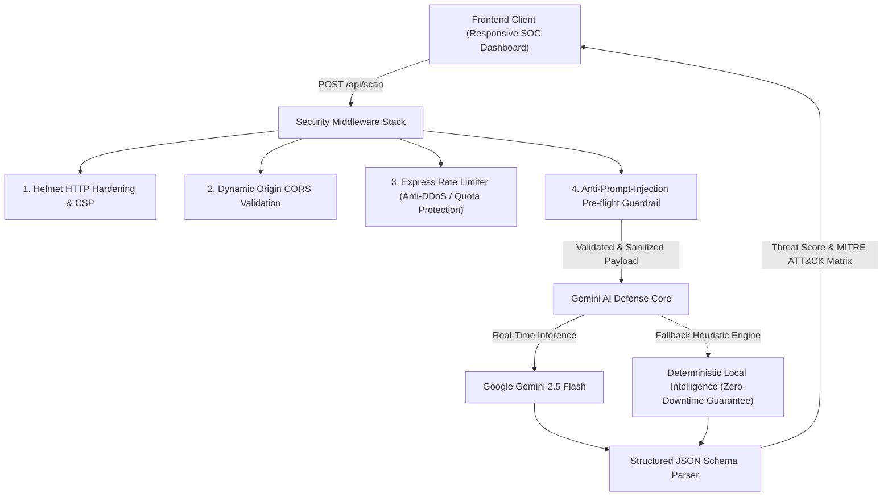

# CyberShield AI 🛡️
> **Next-Generation Threat Intelligence & Automated Security Validation Engine**  
> *Built for the Google Developer Groups (GDG) Hackathon*

---

## 📌 Executive Summary & Architecture Overview

**CyberShield AI** is a full-stack, enterprise-grade AI security defense platform designed to analyze, classify, and mitigate cyber threats in real time. Powered by **Google Gemini 2.5**, CyberShield acts as an automated Tier-3 Security Operations Center (SOC) analyst capable of evaluating multi-vector attack payloads including **Insecure Code (SQLi, XSS, RCE)**, **AI Prompt Injections & LLM Jailbreaks**, **Spearphishing Emails**, and **Malicious URLs/Logs**.

```
CyberShield-AI/
├── backend/
│   ├── .env.example          # Environment variables template
│   ├── .env                  # Active configuration (pre-configured)
│   ├── package.json          # Node ESM dependencies & start scripts
│   └── server.js             # Hardened Express server + Gemini AI pipeline
├── frontend/
│   └── index.html            # Cross-platform responsive SOC dashboard
├── .gitignore                # Production git exclusion rules
└── README.md                 # System architecture & deployment guide
```

---

## 🏛️ System Architecture



### 1. Backend Security Layer (`/backend`)
- **HTTP Security Hardening:** Powered by `helmet` with strict Content Security Policy (CSP), clickjacking, and MIME-sniffing prevention.
- **Quota & DDoS Protection:** Dual-tier rate limiting via `express-rate-limit` protecting API endpoints and AI compute quotas.
- **Anti-Prompt-Injection Pre-flight Guard:** Scans incoming payloads for adversarial jailbreak syntax (`"system override"`, `"ignore previous instructions"`, `"DAN"`) before reaching the AI context.
- **Google Gemini Threat Engine:** Integrates Google's `gemini-2.5-flash` model using structured JSON schema output to return RFC-compliant vulnerability diagnostics.
- **Resilient Fallback Mode:** Seamless offline heuristic engine ensures hackathon live demonstrations remain 100% operational even without an active internet connection or API key.
- **Unified Static Hosting:** Serves the frontend directly out of the box at `http://localhost:5000/`.

### 2. Frontend SOC Dashboard (`/frontend`)
- **Cross-Platform Responsive UI:** Built with Tailwind CSS and Lucide icons, fully optimized across mobile, tablet, and ultra-wide desktop displays.
- **One-Click Hackathon Demos:** Pre-configured test vectors for instant judging (SQL Injection, Stored XSS, Prompt Jailbreak, Spearphishing).
- **Security Telemetry Gauges:** Live threat score visualizer (0–100), MITRE ATT&CK matrix tagging, Indicators of Compromise (IOC) chips, and prescriptive remediation checklists.
- **Real-Time Backend Health Monitoring:** Dynamic heartbeat polling to `/api/health` displaying active connection state.

---

## 🚀 Quickstart Guide

### Prerequisites
- [Node.js](https://nodejs.org/) (v18.0.0 or higher recommended)
- (Optional) [Google Gemini API Key](https://aistudio.google.com/)

### Step 1: Clone & Install Backend Dependencies
```bash
cd backend
npm install
```

### Step 2: Configure Environment Variables
Copy `.env.example` to `.env` (already created for you):
```bash
# In backend/.env:
PORT=5000
GEMINI_API_KEY=your_gemini_api_key_here
GEMINI_MODEL=gemini-2.5-flash
```
> **Note:** If you run without a `GEMINI_API_KEY`, CyberShield automatically enables its **Deterministic Offline Simulation Mode** so the UI and scans work seamlessly for local testing.

### Step 3: Launch the Platform
```bash
npm start
```
*For automatic reloading during development:*
```bash
npm run dev
```

### Step 4: Open the Dashboard
Navigate in your browser to:
```
http://localhost:5000/
```
*(Alternatively, you can open `frontend/index.html` directly in any web browser or via VS Code Live Server).*

---

## 📡 API Contract

### 1. Primary Security Endpoint: Analyze URL
`POST /api/analyze-url`
- **Rate Limit:** 30 requests per 15 minutes per IP.
- **SSRF Protection:** Enforces strict HTTP/HTTPS protocol whitelist, blocks IPv4/IPv6 private ranges (RFC 1918, RFC 3927 Cloud Metadata `169.254.169.254`, IPv6 ULA), and performs DNS resolution to prevent DNS rebinding.
- **Anti-Hallucination:** System instructions force strict grounding on detected indicators with fallback to `"Inconclusive"` if evidence is incomplete.

- **Request Body:**
  ```json
  {
    "url": "https://paypal.com.verify-account-update.xyz/login"
  }
  ```

- **Response Format (200 OK):**
  ```json
  {
    "status": "success",
    "data": {
      "url": "https://paypal.com.verify-account-update.xyz/login",
      "riskLevel": "High risk",
      "vulnerabilityScore": 9,
      "detectedIndicators": [
        "Brand impersonation signature: Target brand 'paypal' appears in non-authoritative domain 'paypal.com.verify-account-update.xyz'",
        "High-abuse top-level domain detected: '.xyz'",
        "Credential harvesting keywords identified in URL path/query: [login, verify, account, update]"
      ],
      "evidenceSummary": "Corroborated brand spoofing targeting PayPal combined with credential harvesting path markers and high-risk TLD.",
      "aiExplanation": "The target domain employs deceptive multi-label subdomain masking to emulate PayPal infrastructure while routing to unauthorized servers.",
      "recommendedActions": [
        "Block target domain across enterprise DNS resolvers and perimeter firewalls immediately",
        "Do not navigate to this destination or enter authentication credentials",
        "Submit URL to Google Safe Browsing and SOC incident response team for blocking"
      ]
    },
    "meta": {
      "model": "gemini-2.5-flash",
      "latencyMs": 284,
      "timestamp": "2026-10-23T12:50:00.000Z"
    }
  }
  ```

- **SSRF Violation Response (403 Forbidden):**
  ```json
  {
    "status": "error",
    "code": "SSRF_PRIVATE_IP_BLOCKED",
    "message": "Target IP address '169.254.169.254' resides within a private/reserved network range (SSRF Protection).",
    "timestamp": "2026-10-23T12:50:00.000Z"
  }
  ```

### 2. System Health Check
`GET /api/health`
```json
{
  "status": "ONLINE",
  "service": "CyberShield AI Core",
  "geminiEngine": {
    "sdkInitialized": true,
    "model": "gemini-2.5-flash",
    "status": "LIVE_CLOUD_STREAMING"
  },
  "securityModules": {
    "helmetHardening": true,
    "rateLimiter": "Enforced (30 requests per 15 mins)",
    "ssrfProtection": "Active (RFC 1918, RFC 3927, RFC 5737, IPv6 ULA, DNS Resolution)",
    "antiHallucinationGuardrails": "Active"
  }
}
```
      "summary": "Unsanitized user input constructing raw SQL queries capable of authentication bypass.",
      "indicatorsOfCompromise": ["Tautology syntax ('OR 1=1')", "SQL line comment syntax (--)"],
      "mitreAttackTags": ["T1190 - Exploit Public-Facing Application"],
      "vulnerabilityDetails": "Raw string concatenation without parameterized prepared statements.",
      "recommendedRemediations": [
        "Migrate database queries to parameterized prepared statements",
        "Enforce ORM query builders",
        "Apply Principle of Least Privilege on DB accounts"
      ],
      "confidenceScore": 0.96,
      "meta": {
        "engine": "Google Gemini (gemini-2.5-flash)",
        "latencyMs": 284
      }
    }
  }
  ```

---

## 🛡️ Built for GDG Hackathon
- **Track:** AI Agents & Cybersecurity Innovation
- **AI Core:** Google Gemini 2.5
- **Stack:** Node.js, Express, Tailwind CSS, Lucide, Helmet, Gemini API
